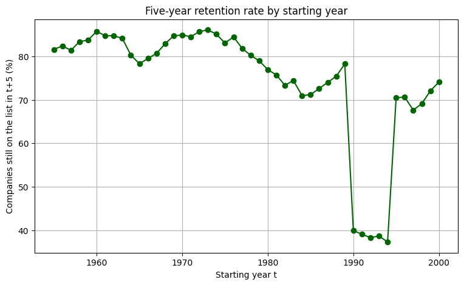
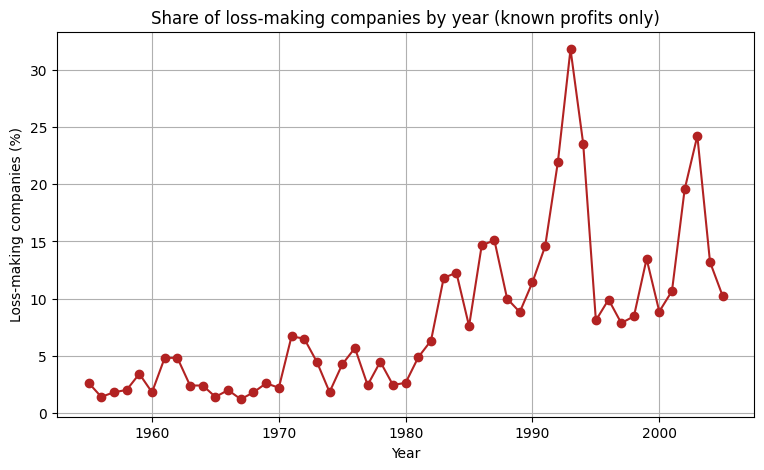
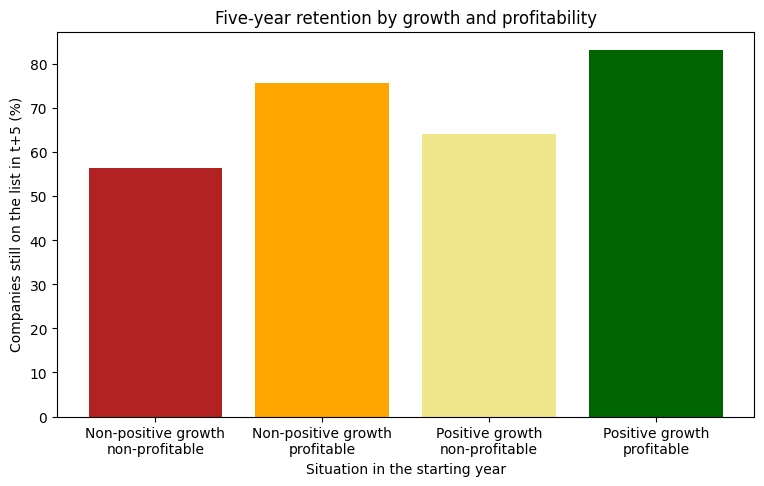

# Staying on Top: Growth, Profitability and Retention in the Fortune 500 (1955–2005)

Exploratory data analysis of 51 years of Fortune 500 rankings (25,500 company-years). We look at how big US companies grow, how profitable they are, and how often they're still on the list five years later.

> **Research question:** Are revenue growth and profitability associated with staying in the Fortune 500 five years later, and has staying on the list become harder over time?

## Key findings

**1. Staying on top got harder.** Five-year retention was about **83%** from the 1950s to the 1970s. It fell to **70–74%** from the 1980s to 2000, and the drop shows up even among the top 100 companies.

*The collapse for 1990–1994 isn't real churn. In 1995 Fortune started ranking service companies alongside industrial ones, and 290 of the 500 names changed in a single year. We spotted this in the data and left those years out of the comparisons.*

**2. Losses became much more common.** Before 1980, fewer than 5% of companies reported a loss in a typical year. The share reached **31.8% in 1993** and **24.2% in 2003**. The median margin stayed at 4–5% throughout, but the spread between winners and losers doubled.

**3. Profitability matters more than growth.** Companies that were both growing and profitable stayed on the list **83%** of the time, compared with **56%** for those that were neither. The gap holds within every size group and is widest near the bottom of the ranking.

**4. Bigger companies grow more slowly.** Median annual growth is 7.1% for ranks 1–100 and 9.7% for ranks 401–500, though part of that gap is a selection effect.

## What's in the notebook

| Section | Content |
|---|---|
| Data cleaning | Converting `"N.A."` profits to missing values, detecting duplicate company names, sanity checks |
| Feature engineering | Profit margin, size group, loss flag, year-over-year revenue growth (self-merge on t−1), five-year retention (merge on t+5) |
| EDA | Distributions, outliers (±3σ), time trends, heatmaps by decade × size group |
| Summary | Answers to the research question, managerial implications, limitations |

## Tools

Python · pandas · matplotlib · seaborn · numpy · Google Colab

## Data

[Fortune 500 companies, 1955–2005](https://raw.githubusercontent.com/cybersamx/notebooks/master/data/fortune500.csv): year, rank, company, revenue and profit, in nominal millions of USD. The notebook loads the dataset directly from this URL, so you don't need to download anything.

## Limitations

The figures are nominal (not adjusted for inflation). Companies are matched on their exact name, so a merger or renaming counts as an exit. The data has no industry variable and ends in 2005. All results are descriptive associations, not causal effects.

## Team

Group project for *AI-Powered Data Analysis using Python & Agile*, EM Normandie (November 2026).
Noé Cauche · **Giuliano Cerullo** · Yan Descoubes · Mathis Gouinguenet · Nasser Kettani
